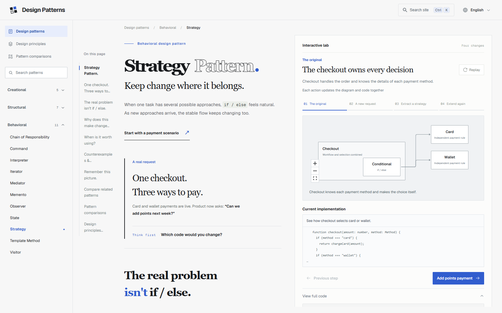

<p align="center">
  
</p>

<h1 align="center">Design Patterns</h1>

<p align="center">Understand design patterns through interactive diagrams and code.</p>

<p align="center">
  <a href="README.zh-CN.md">简体中文</a> · English
</p>

<p align="center">
  <a href="LICENSE"></a>
</p>

An educational website covering **23 GoF design patterns**, **7 object-oriented design principles**, and **10 comparisons of commonly confused patterns**. Built for reading and exploration, with Chinese and English content.

## Preview



## Contents

- [Features](#features)
- [Learning content](#learning-content)
- [Getting started](#getting-started)
- [Production build](#production-build)
- [Tech stack](#tech-stack)
- [Project structure](#project-structure)
- [Checks and tests](#checks-and-tests)
- [Contributing](#contributing)
- [Acknowledgments](#acknowledgments)
- [License](#license)

## Features

- **Pattern-specific teaching.** Each lesson explains a concrete problem, the underlying idea, benefits, tradeoffs, suitable scenarios, and related patterns.
- **Interactive exploration.** Pattern-specific experiments and step-by-step structural diagrams make relationships visible. Diagram changes, explanations, code snapshots, and highlighted lines follow the selected walkthrough step.
- **Four code languages.** TypeScript, Python, Java, and Go examples, with syntax highlighting, language selection, copying, and optional code diffs.
- **Design principles and comparisons.** Explore SOLID plus two principles, or compare similar patterns through a shared scenario, diagrams, and selection questions.
- **Counterexamples and overengineering.** Every pattern includes misuse, added costs, a simpler alternative, and concrete signals for reconsidering it.
- **Bilingual content.** Chinese and English use JSON message catalogs through next-intl. Website language and code language are independent.
- **Full-site search.** Pagefind indexes rendered lessons, principles, and comparisons locally, with Ctrl/Cmd + K and language-specific results.
- **Reading-focused layout.** Independent reading and experiment panes on desktop; a stacked, document-scrolling layout on mobile. The chapter menu is derived from article headings.
- **SEO and accessibility.** Prerendered pages, canonical URLs, hreflang, structured data, sitemap, keyboard-accessible controls, and reduced-motion support.

> Code examples are educational snapshots. The site does not execute arbitrary code in the browser. Walkthrough steps update code, but experiment actions do not universally trace live execution into code lines. The current interface is light-only.

## Learning content

### Design patterns

- **Creational (5):** Singleton, Factory Method, Abstract Factory, Builder, Prototype.
- **Structural (7):** Adapter, Bridge, Composite, Decorator, Facade, Flyweight, Proxy.
- **Behavioral (11):** Chain of Responsibility, Command, Interpreter, Iterator, Mediator, Memento, Observer, State, Strategy, Template Method, Visitor.

### Design principles

Single Responsibility, Open/Closed, Liskov Substitution, Interface Segregation, Dependency Inversion, Composition over Inheritance, and the Law of Demeter.

### Pattern comparisons

Ten pairs of commonly confused patterns, with distinctions, use cases, and explanations of how they can coexist.

## Getting started

### Requirements

- **Node.js 22.18 or newer** and npm. Project scripts import TypeScript directly using Node's built-in type stripping.
- No database, API key, or external search service is required.
- Python, Java, Go, and Chrome are only required for the corresponding verification scripts, not for running the website.

Clone or download this repository, enter its directory, then run:

```bash
npm ci
npm run dev
```

Open [http://localhost:3000](http://localhost:3000).

| Section | Chinese | English |
| --- | --- | --- |
| Patterns | `/` | `/en` |
| Principles | `/principles` | `/en/principles` |
| Comparisons | `/comparisons` | `/en/comparisons` |
| Example lesson | `/patterns/strategy` | `/en/patterns/strategy` |

The development command starts Next.js and generates the search index from local pages. Search may be unavailable briefly during the initial crawl. Content changes trigger index refreshes; use `npm run search:dev` to rebuild it manually.

## Production build

Set the public site URL before building, for example in `.env.local`:

```dotenv
NEXT_PUBLIC_SITE_URL=https://patterns.example.com
```

Replace the example with your own origin. This value is used for canonical URLs, structured data, robots.txt, and sitemap URLs. It is optional for local development.

```bash
npm run build
npm run start
```

`npm run build` runs the Next.js production build and then generates the Pagefind bundle under `public/pagefind/`. **Include this directory in deployment artifacts** even though it is ignored by Git. Run the complete build command, not only `next build`.

Deploy as a Next.js application; this project is not configured for a plain static export. Generate the index again after changing content.

## Tech stack

| Area | Tools |
| --- | --- |
| Application | Next.js 16 App Router, React 19, TypeScript |
| Styling and motion | Tailwind CSS 4, custom CSS, Motion |
| Localization | next-intl |
| Accessible controls | Radix UI primitives |
| Structure diagrams | React Flow, Dagre |
| Code highlighting and diffs | react-syntax-highlighter (Prism Light), diff |
| Chapter navigation | Tocbot |
| Search | Pagefind and its official component UI |
| Browser checks | Playwright |

## Project structure

```text
src/
  app/                Locale-aware routes and SEO
  components/         Lessons, navigation, diagrams, and experiments
  code-examples/      Language registry and staged code examples
  data/               Pattern, principle, and comparison registries
  i18n/               Routing, message loading, and localized JSON
public/
  brand/              Logo and generated site icons
  icons/              Pattern, principle, and language icons
scripts/              Build utilities, content checks, and browser smoke tests
assets/screenshots/   README preview images
```

To extend the content, use the registries in `src/data/` and the JSON catalogs in `src/i18n/messages/`. Website languages are registered in `src/i18n/routing.ts`; code languages in `src/code-examples/languages.ts`.

## Checks and tests

Basic checks:

```bash
npm run lint
npx tsc --noEmit
npm run verify:i18n
npm run verify:comparisons
npm run verify:overengineering
npm run build
```

Optional checks:

| Command | Purpose | Extra requirements |
| --- | --- | --- |
| `npm run verify:examples` | Strategy code examples | Python for the Python examples |
| `npm run verify:patterns` | Other patterns' TypeScript and Python snapshots | Python available as `python` |
| `npm run verify:java-go` | Java and Go snapshots for all patterns | Java 17+ and Go |
| `npm run smoke:patterns` | Pattern pages, code controls, routes, and SEO | Running local server and Chrome |
| `npm run smoke:composition` | Homepage SVG compositions | Running local server and Chrome |
| `npm run smoke:chapters` | Generated chapter menus and navigation | Running local server and Chrome |
| `npm run smoke:scroll` | Desktop split scrolling and mobile layout | Running local server and Chrome |
| `npm run smoke:search` | Full-site search | Running local server, generated index, and Chrome |
| `npm run smoke:overengineering` | Bilingual counterexamples and navigation | Running local server and Chrome |

Browser scripts use Google Chrome; set `CHROME_PATH` if it is not installed at the default Windows path. Scripts that support a custom server use `PATTERN_ATLAS_URL`; some existing scripts still use `localhost:3000`.

For Java/Go checks, use `JAVA_BIN` and `GO_BIN` to specify executable paths. On Windows, the current script defaults to `D:/java17/bin/java.exe` and `D:/go/bin/go.exe`; override them for your machine. On other platforms it uses executables on PATH.

## Contributing

Issues and pull requests are welcome, especially for:

- Incorrect explanations, unclear interactions, or misleading examples.
- Translation improvements and additional website languages.
- Additional code languages and better teaching scenarios.
- Accessibility and responsive-layout fixes.

Before opening a pull request:

1. Describe the problem and intended change.
2. Keep content in localized JSON and follow the existing registries instead of adding page-specific language branches.
3. Update both existing language catalogs when adding shared content.
4. Run the relevant checks above. Include screenshots for visible changes.

For a content correction, mention the pattern or principle, website language, code language if relevant, and the affected passage or step.

## Acknowledgments

- The Gang of Four for the design-pattern taxonomy.
- The open-source projects listed in the tech stack.
- [Devicon](https://github.com/devicons/devicon) for programming-language icons. Its original MIT notice is retained in [public/icons/languages/LICENSE](public/icons/languages/LICENSE).

Third-party dependencies and assets retain their own licenses; the project license does not replace those notices.

## License

[MIT](LICENSE). Copyright © 2026 Design Patterns contributors.
