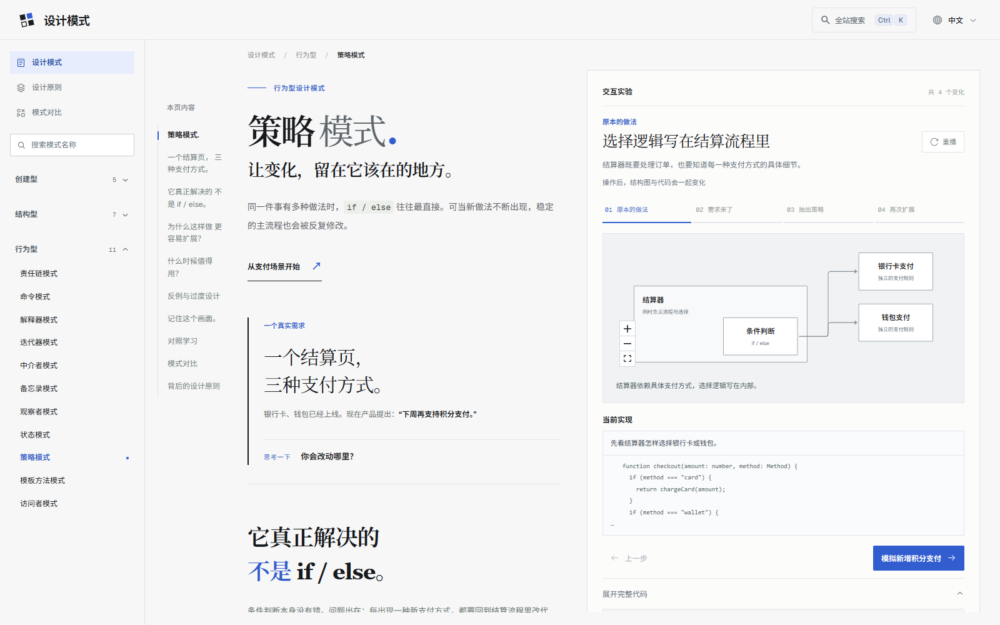

<p align="center">
  
</p>

<h1 align="center">设计模式 · Design Patterns</h1>

<p align="center">通过交互图解与代码，理解设计模式。</p>

<p align="center">
  简体中文 · <a href="README.md">English</a>
</p>

<p align="center">
  <a href="LICENSE"></a>
</p>

一个面向开发者的教学网站，包含 **23 种 GoF 设计模式**、**7 大面向对象设计原则**和 **10 组易混淆模式对比**，支持中文与英文。

## 项目预览



## 目录

- [功能特点](#功能特点)
- [学习内容](#学习内容)
- [快速开始](#快速开始)
- [构建与部署](#构建与部署)
- [技术栈](#技术栈)
- [项目结构](#项目结构)
- [检查与测试](#检查与测试)
- [参与贡献](#参与贡献)
- [致谢](#致谢)
- [开源协议](#开源协议)

## 功能特点

- **模式专属讲解**：从具体问题出发，解释核心思想、收益、代价、适用场景与相关模式，不套用一份通用介绍。
- **交互与结构演变**：各模式具有对应的实验或演示。结构图、步骤说明、代码快照与高亮行随所选教学步骤同步变化。
- **四种代码语言**：支持 TypeScript、Python、Java、Go，提供语法高亮、语言切换、复制和按需展开的代码差异。
- **设计原则与模式对比**：独立学习 SOLID + 2 原则；通过共同场景、图解和选型问题理解相似模式的区别。
- **反例与过度设计**：每个模式都包含具体误用、额外成本、简单替代方案，以及值得重新考虑该模式的变化信号。
- **中英文内容**：使用 next-intl 与 JSON 语言文件；网站语言与代码语言分别切换。
- **全站搜索**：Pagefind 本地索引模式、原则和对比正文，支持 Ctrl/Cmd + K 与按网站语言检索。
- **阅读友好布局**：桌面采用阅读区与实验区独立滚动；手机采用上下排列、整页滚动。子目录直接从正文标题生成。
- **SEO 与可访问性**：页面预渲染、canonical、hreflang、结构化数据、sitemap、键盘操作与减少动态效果支持。

> 代码是教学快照，网站不会在浏览器中执行任意代码。教学步骤会联动代码，但独立实验的操作并非全部支持运行过程逐行追踪。当前网站仅提供浅色界面。

## 学习内容

### 设计模式

- **创建型（5）**：单例、工厂方法、抽象工厂、建造者、原型。
- **结构型（7）**：适配器、桥接、组合、装饰器、外观、享元、代理。
- **行为型（11）**：职责链、命令、解释器、迭代器、中介者、备忘录、观察者、状态、策略、模板方法、访问者。

### 设计原则

单一职责、开闭、里氏替换、接口隔离、依赖倒置、合成复用、迪米特法则。

### 模式对比

提供 10 组常见易混淆模式，解释关键区别、适用情况，以及两种模式可以如何共存。

## 快速开始

### 环境要求

- **Node.js 22.18 或更高版本**及 npm。项目脚本通过 Node 内建的类型擦除功能直接导入 TypeScript。
- 不需要数据库、API Key 或外部搜索服务。
- Python、Java、Go 和 Chrome 仅用于相应的校验脚本，不是启动网站的必需条件。

克隆或下载此仓库，进入项目目录后执行：

```bash
npm ci
npm run dev
```

访问 [http://localhost:3000](http://localhost:3000)。

| 栏目 | 中文地址 | 英文地址 |
| --- | --- | --- |
| 设计模式 | `/` | `/en` |
| 设计原则 | `/principles` | `/en/principles` |
| 模式对比 | `/comparisons` | `/en/comparisons` |
| 示例详情 | `/patterns/strategy` | `/en/patterns/strategy` |

开发命令会启动 Next.js，并抓取本地页面生成搜索索引。首次抓取期间搜索可能暂时不可用，内容变化后会刷新索引；也可通过 `npm run search:dev` 手动更新。

## 构建与部署

构建前设置正式站点地址，例如在 `.env.local` 中配置：

```dotenv
NEXT_PUBLIC_SITE_URL=https://patterns.example.com
```

将示例替换为自己的站点域名。该值用于 canonical、结构化数据、robots.txt 与 sitemap；本地开发可以不配置。

```bash
npm run build
npm run start
```

`npm run build` 先构建 Next.js，再将 Pagefind 搜索资源生成到 `public/pagefind/`。**部署产物必须包含这个目录**，虽然它不会提交到 Git。请运行完整构建命令，不要只执行 `next build`。

按 Next.js 应用部署；当前项目未配置纯静态导出。内容更新后需要重新生成索引。

## 技术栈

| 领域 | 工具 |
| --- | --- |
| 应用框架 | Next.js 16 App Router、React 19、TypeScript |
| 样式与动画 | Tailwind CSS 4、自定义 CSS、Motion |
| 多语言 | next-intl |
| 可访问交互组件 | Radix UI primitives |
| 结构图 | React Flow、Dagre |
| 代码高亮与差异 | react-syntax-highlighter（Prism Light）、diff |
| 正文子导航 | Tocbot |
| 全站搜索 | Pagefind 与官方组件 UI |
| 浏览器检查 | Playwright |

## 项目结构

```text
src/
  app/                多语言路由与 SEO
  components/         教程、导航、结构图与交互实验
  code-examples/      开发语言注册与分阶段代码案例
  data/               设计模式、原则与对比注册表
  i18n/               语言路由、消息加载与 JSON 文案
public/
  brand/              Logo 与生成的网站图标
  icons/              模式、原则与开发语言图标
scripts/              构建工具、内容校验与浏览器冒烟测试
assets/screenshots/   README 展示图
```

扩展内容时，沿用 `src/data/` 的注册表与 `src/i18n/messages/` 的 JSON 文案。网站语言在 `src/i18n/routing.ts` 注册，代码语言在 `src/code-examples/languages.ts` 注册。

## 检查与测试

基础检查：

```bash
npm run lint
npx tsc --noEmit
npm run verify:i18n
npm run verify:comparisons
npm run verify:overengineering
npm run build
```

可选检查：

| 命令 | 检查内容 | 额外要求 |
| --- | --- | --- |
| `npm run verify:examples` | 策略模式代码案例 | 校验 Python 案例时需要 Python |
| `npm run verify:patterns` | 其他模式的 TypeScript、Python 快照 | `python` 命令可用 |
| `npm run verify:java-go` | 全部模式的 Java、Go 快照 | Java 17+ 与 Go |
| `npm run smoke:patterns` | 模式页面、代码控件、路由与 SEO | 已启动本地服务及 Chrome |
| `npm run smoke:composition` | 首页 SVG 组合动画 | 已启动本地服务及 Chrome |
| `npm run smoke:chapters` | 自动子目录与章节跳转 | 已启动本地服务及 Chrome |
| `npm run smoke:scroll` | 桌面分屏滚动与手机布局 | 已启动本地服务及 Chrome |
| `npm run smoke:search` | 全站搜索 | 本地服务、已生成索引及 Chrome |
| `npm run smoke:overengineering` | 中英文反例与目录跳转 | 已启动本地服务及 Chrome |

浏览器脚本使用 Google Chrome；安装位置不是默认 Windows 路径时，设置 `CHROME_PATH`。支持自定义服务地址的脚本读取 `PATTERN_ATLAS_URL`；部分现有脚本仍固定使用 `localhost:3000`。

Java、Go 校验可通过 `JAVA_BIN` 和 `GO_BIN` 指定可执行文件。在 Windows 上，现有脚本默认路径为 `D:/java17/bin/java.exe` 和 `D:/go/bin/go.exe`，请按本机环境覆盖；其他平台使用 PATH 中的命令。

## 参与贡献

欢迎通过 Issue 或 Pull Request 参与，尤其是：

- 修正不准确的解释、不直观的交互或误导性案例。
- 完善翻译，增加网站语言。
- 增加代码语言，改进教学场景。
- 改善可访问性与响应式布局。

提交 Pull Request 前：

1. 说明问题与预期改动。
2. 将文案放在语言 JSON 中，沿用现有注册表，避免增加逐页面的语言条件分支。
3. 新增公共内容时同步更新两种现有语言资源。
4. 执行相关检查；界面变化请附上截图。

反馈教学内容时，请注明模式或原则、网站语言、相关代码语言，以及具体段落或步骤。

## 致谢

- GoF（Gang of Four）提出的设计模式分类。
- 技术栈中使用的开源项目。
- [Devicon](https://github.com/devicons/devicon) 提供的开发语言图标。原始 MIT 声明保留于 [public/icons/languages/LICENSE](public/icons/languages/LICENSE)。

第三方依赖与资源仍遵循各自的许可证，本项目协议不会替代这些声明。

## 开源协议

[MIT](LICENSE)。Copyright © 2026 Design Patterns contributors。
